<div align="center">
  

  <br />

  <a href="https://www.chandrateja.dev"></a>
  <a href="https://www.linkedin.com/in/chandra-teja-pannem/"></a>
  <a href="https://leetcode.com/u/q4i6j3jtL8/"></a>
</div>

<br />

I like the **“wait, why does this do that?”** moment. Then I open the source.

I build things around **quantum software, developer tools, systems, and applied AI** — usually somewhere between learning the idea properly and turning it into something people can actually poke at.

```text
current mode  →  build · break · understand · repeat
```

## ✦ What I'm building

<table>
  <tr>
    <td width="50%" valign="top">
      <h3><a href="https://github.com/Asterisk-Hunter/entanglement">Entanglement Trap</a></h3>
      <p>An interactive quantum channel-discrimination lab built around one question: <strong>does maximum entanglement always help?</strong></p>
      <p><code>Python</code> <code>Qiskit</code> <code>Quantum Information</code></p>
      <a href="https://qollab.xyz/p/01a1299b-dba2-772e-a6e7-8012098938f0">Live project ↗</a>
    </td>
    <td width="50%" valign="top">
      <h3><a href="https://github.com/Asterisk-Hunter/KOJ">KOJ</a></h3>
      <p><strong>Kottayam Online Judge</strong> — an online judge I'm building as a proper full-stack system rather than a throwaway coding-project demo.</p>
      <p><code>TypeScript</code> <code>Next.js</code> <code>Systems</code></p>
      <a href="https://koj-livid.vercel.app">Live ↗</a>
    </td>
  </tr>
  <tr>
    <td width="50%" valign="top">
      <h3><a href="https://github.com/Asterisk-Hunter/Indic-auto-complete-engine">Indic Autocomplete Engine</a></h3>
      <p>Exploring autocomplete and language tooling for Indic-language text.</p>
      <p><code>NLP</code> <code>Language Tech</code></p>
    </td>
    <td width="50%" valign="top">
      <h3><a href="https://github.com/Asterisk-Hunter/LogSage">LogSage</a></h3>
      <p>Developer-tooling experiments around making noisy logs easier to reason about.</p>
      <p><code>Developer Tools</code> <code>AI</code></p>
    </td>
  </tr>
</table>

## ⟡ Things I keep coming back to

- **Quantum software** — Qiskit, circuits, channel discrimination, and learning what the math is actually saying.
- **Systems & tooling** — online judges, protocols, networking, automation, and tools that remove annoying work.
- **Applied AI** — useful systems over wrapper-for-the-sake-of-wrapper demos.
- **Open source** — reading real codebases, finding the sharp edges, and learning by contributing where I can.

## ⚙️ Working set

<p>
  
  
  
  
  
  
</p>

<sub>Not a list of everything I've touched — just the stuff I actually keep reaching for.</sub>

## ◌ Open-source corners

<table>
  <tbody>
    <tr>
      <td align="center"><a href="https://github.com/Submitty"></a><br /><sub>Submitty</sub></td>
      <td align="center"><a href="https://github.com/Qiskit"></a><br /><sub>Qiskit</sub></td>
      <td align="center"><a href="https://github.com/BodyMaps"></a><br /><sub>BodyMaps</sub></td>
      <td align="center"><a href="https://github.com/PennyLaneAI"></a><br /><sub>PennyLane</sub></td>
      <td align="center"><a href="https://github.com/unitaryfoundation"></a><br /><sub>Unitary Foundation</sub></td>
    </tr>
  </tbody>
</table>

<br />

> **I don't want to just know that something works. I want to know why — and then build with it.**

<br />

<div align="center">
  <picture>
    <source media="(prefers-color-scheme: dark)" srcset="https://raw.githubusercontent.com/Asterisk-Hunter/Asterisk-Hunter/output/contribution-snake-dark.svg" />
    <source media="(prefers-color-scheme: light)" srcset="https://raw.githubusercontent.com/Asterisk-Hunter/Asterisk-Hunter/output/contribution-snake.svg" />
    
  </picture>
</div>

<div align="center">
  <sub>open source · building · figuring it out</sub>
</div>
